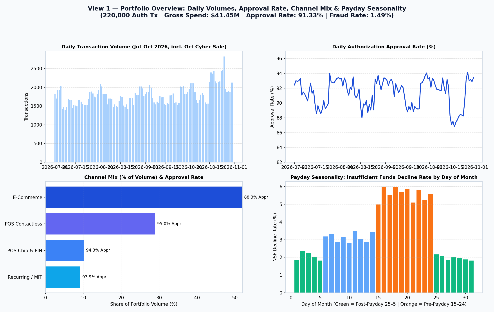
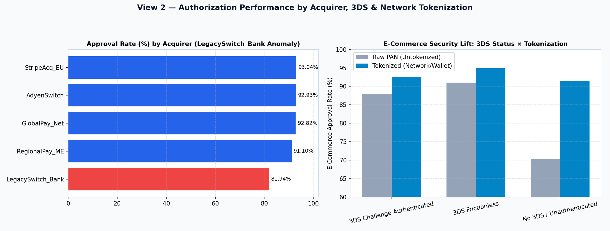
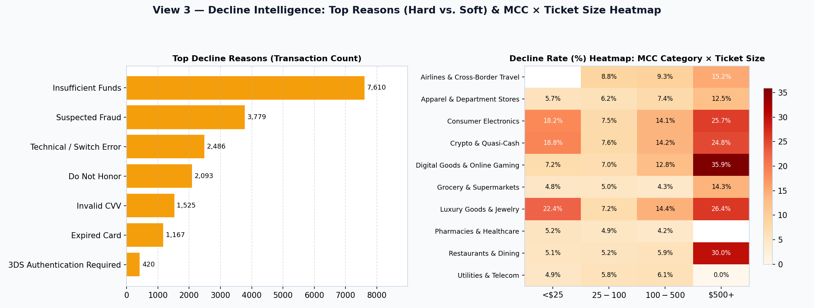
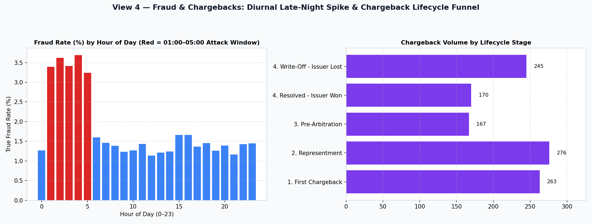
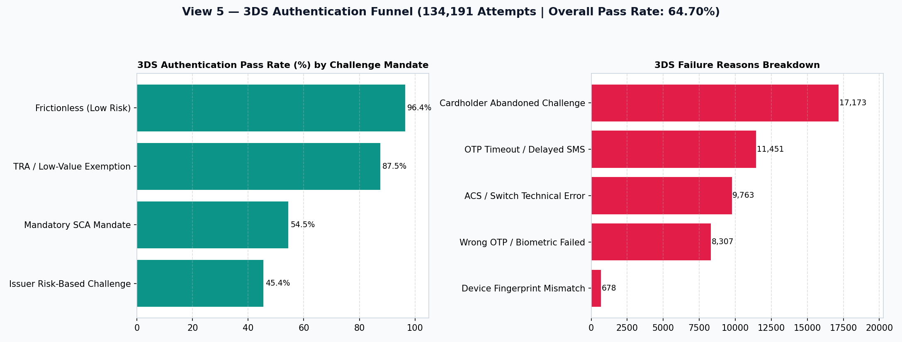
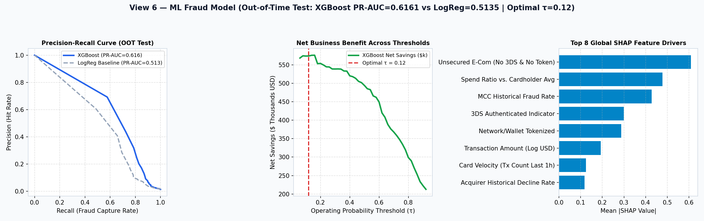

# 💳 Issuer Authorization Analytics, Fraud ML & Grounded AI Insights Engine

**End-to-End Technical Case Study Solution | AI Data Scientist**

An end-to-end issuer-side payment analytics platform combining **realistic synthetic payment data generation (220,000 authorization rows + 134,191 3DS authentication logs across 4 months, mapped 1-to-1 with CNP transactions)**, a **time-based machine learning fraud scoring pipeline (Logistic Regression Baseline vs. XGBoost + SHAP + Operating Threshold Simulator)**, a **6-view executive web dashboard**, and a **grounded LLM-powered AI Insights Engine**.

---

## 🚀 Quick Start (Local Reproducible Run)

### 1. Install Dependencies

```bash
pip install -r requirements.txt
```

### 2. (Optional) Configure LLM API Key

Copy `.env.example` to `.env` and add an API key (`GROQ_API_KEY` or `GEMINI_API_KEY`):

```bash
cp .env.example .env
```

> **Zero-Key Offline Resilience:** If no API key is configured (or if a corporate firewall blocks outbound API traffic), the dashboard's **AI Insights Engine** automatically uses its built-in **Deterministic Grounded Analytics Engine** so every feature works 100% out-of-the-box with zero configuration.

### 3. Launch the Interactive Web Dashboard

```bash
streamlit run app.py
```

*(Note: Pre-generated datasets in `data/*.parquet` and trained models in `models/*` are included and load in `<1 second`. If deleted, `app.py` automatically regenerates and retrains them on first boot.)*

### 4. Re-Run Data Generation & ML Training Manually (Optional)

```bash
python -m src.data_generator
python -m src.ml_pipeline
python -m src.generate_fallback_visuals
```

---

## ☁️ Free Cloud Hosting on Streamlit Community Cloud (From Your GitHub)

1. Push this repository to your **GitHub** account (notice `.gitignore` automatically blocks `.env` so no secrets ever enter Git).
2. Go to **[share.streamlit.io](https://share.streamlit.io)** and sign in with GitHub.
3. Click **"Create app"** $\rightarrow$ select your repository, branch (`main`), and main file path: **`app.py`**.
4. *(Optional)* Click **Advanced settings $\rightarrow$ Secrets** and paste your API key:
   ```toml
   OPENAI_API_KEY = "sk-..."
   ```
5. Click **Deploy!** Within 2 minutes you will have a public live URL (e.g., `https://your-app-name.streamlit.app`) hosting the dashboard, the ML models, the What-If Threshold Simulator, and the AI Insights Engine.

---

## 📂 Repository Structure

```text
├── app.py                              # Main Streamlit Executive Dashboard (7 Tabs + Global Filters)
├── src/
│   ├── data_generator.py               # Synthetic data generator (220k Auth Tx + 134k 3DS Logs, 4 months)
│   ├── ml_pipeline.py                  # Time-based split, LogReg vs XGBoost, SHAP, Threshold Economics
│   ├── ai_engine.py                    # Deterministic context builder, LLM client & Grounding Guardrails
│   ├── generate_fallback_visuals.py    # Generates high-res fallback PNG snapshots in screenshots/
│   └── build_writeup_docx.py           # Builds the formatted 2-page Word write-up
├── data/
│   ├── authorization_transactions.parquet  # 220,000 synthetic authorization records (Jul–Oct 2026)
│   ├── authentication_3ds.parquet          # 134,191 synthetic 3DS authentication records (1-to-1 CNP mapping)
│   └── scored_predictions.parquet          # Out-of-time & portfolio ML scores, risk tiers & SHAP tags
├── models/
│   ├── ml_results.json                 # Validation/Test metrics, ROC/PR curves, SHAP & Threshold curves
│   ├── xgb_model.joblib                # Trained XGBoost Classifier artifact
│   └── lr_baseline.joblib              # Trained Logistic Regression Baseline pipeline
├── screenshots/                        # High-resolution fallback screenshots of all 6 dashboard views
├── WRITEUP_2_PAGE.md                   # 2-Page Technical Write-Up (Markdown)
├── Case_Study_Writeup_2Pages.docx      # 2-Page Technical Write-Up (Word .docx for submission)
├── WALKTHROUGH_20MIN_SCRIPT.md         # 20-Minute Live Walkthrough Presentation Script & Q&A Guide
├── requirements.txt                    # Reproducible Python dependencies
├── .env.example                        # Template for backend API keys (no secrets committed)
└── .gitignore                          # Excludes .env, secrets, and temp artifacts
```

---

## 🖼️ Fallback Dashboard Visuals (Corporate Network Safe)

In case external cloud links are blocked by corporate firewalls, high-resolution visual snapshots of every view are stored in `screenshots/`:

### View 1 — Portfolio Overview & Seasonality



### View 2 — Authorization Performance (Acquirer, 3DS & Tokenization)



### View 3 — Decline Intelligence (Hard vs. Soft & MCC × Ticket Size Heatmap)



### View 4 — Fraud & Chargebacks (Diurnal Spike & Lifecycle Funnel)



### View 5 — 3DS Authentication Pre-Authorization Funnel



### View 6 — Machine Learning Model, SHAP Drivers & Threshold Business Impact


